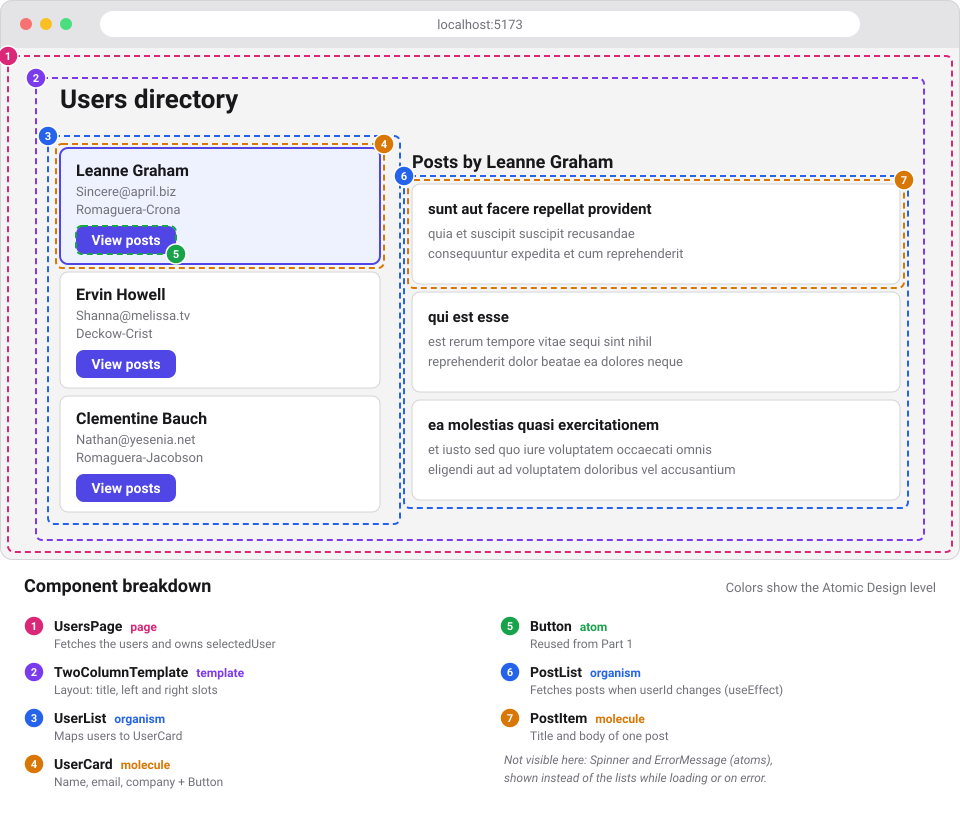

# React Basics, Part 2: `useEffect` and the Component Lifecycle

> Continues [Part 1](./01-react-components-and-atomic-design.md). We assume you already know components, props, `useState`, and the to-do app built there. Goal: understand **when** a component's code runs, what a **side effect** is, and how to handle effects with `useEffect` while keeping our component-based design clean.

## Table of contents

1. [Recap and goals](#1-recap-and-goals)
2. [The component lifecycle](#2-the-component-lifecycle)
3. [Rendering must be pure: what is a side effect?](#3-rendering-must-be-pure-what-is-a-side-effect)
4. [`useEffect` step by step](#4-useeffect-step-by-step)
5. [Common pitfalls](#5-common-pitfalls)
6. [You might not need an effect](#6-you-might-not-need-an-effect)
7. [Example A: improving the to-do app](#7-example-a-improving-the-to-do-app)
8. [Example B: a users directory with an API](#8-example-b-a-users-directory-with-an-api)
9. [Suggested exercises](#9-suggested-exercises)
10. [Summary](#10-summary)

---

## 1. Recap and goals

In Part 1 every component was a **pure function of its props and state**: given the same inputs, it returned the same JSX. That is the ideal, but real apps also need to:

- Fetch data from a server.
- Save data in the browser (`localStorage`).
- Start timers or subscribe to events.
- Change things outside React (`document.title`).

None of these is "calculating JSX". They are **side effects**, and `useEffect` is the tool React gives us to run them in the right moment.

**By the end of this part you will be able to:**

- Describe the three phases of a component's life: mount, update, unmount.
- Explain the difference between *rendering* and *running an effect*.
- Use the dependency array and the cleanup function correctly.
- Extract effects into **custom hooks** so components stay small and focused.

---

## 2. The component lifecycle

A component instance goes through three phases:

| Phase | When | Typical examples |
|---|---|---|
| **Mount** | The component appears on screen for the first time | Fetch initial data, read `localStorage` |
| **Update** | Its props or state change and it is rendered again | React to a new `userId`, save new state |
| **Unmount** | The component is removed from the screen | Clear timers, cancel requests, unsubscribe |

### Render phase vs. commit phase

Every time React updates the screen, it does two things:

```
 trigger            render               commit               effects
(mount, setState,  (React calls your   (React updates the    (React runs your
 new props)         function; JSX is    real DOM)             useEffect code)
                    calculated)
```

1. **Render**: React calls your component function. It must be **pure** (no side effects here).
2. **Commit**: React applies the changes to the DOM.
3. **Effects**: *after* the screen has been updated, React runs your `useEffect` callbacks.

> 💡 This is why `useEffect` is the right place for side effects: the UI is already painted, and the render stays free of surprises.

### A quick note for people who know class components

You may see old tutorials with class lifecycle methods. The rough equivalence is:

| Class component | Function component |
|---|---|
| `componentDidMount` | `useEffect(() => { ... }, [])` |
| `componentDidUpdate` | `useEffect(() => { ... }, [dep])` |
| `componentWillUnmount` | the **cleanup function** returned by an effect |

Do not memorize this as a one-to-one mapping. In hooks we think in terms of **synchronization** ("keep this external thing in sync with this data") rather than "moments in time".

### Seeing the lifecycle with our own eyes

Create a small component that logs what happens:

```jsx
// src/components/atoms/LifecycleLogger.jsx
import { useEffect, useState } from 'react'

export default function LifecycleLogger() {
  const [count, setCount] = useState(0)

  console.log('1. render, count =', count)

  useEffect(() => {
    console.log('2. effect runs (mount)')
    return () => console.log('4. cleanup (unmount)')
  }, [])

  useEffect(() => {
    console.log('3. effect runs because count changed ->', count)
  }, [count])

  return <button onClick={() => setCount(count + 1)}>Clicked {count} times</button>
}
```

```jsx
// src/App.jsx (temporary test)
import { useState } from 'react'
import LifecycleLogger from './components/atoms/LifecycleLogger'

export default function App() {
  const [visible, setVisible] = useState(true)
  return (
    <>
      <button onClick={() => setVisible(!visible)}>Toggle</button>
      {visible && <LifecycleLogger />}
    </>
  )
}
```

Open the console and:

1. Load the page → you see the render and both effects (**mount**).
2. Click the counter → a render and only the effect that depends on `count` (**update**).
3. Click Toggle → the cleanup runs (**unmount**).

> ⚠️ **React Strict Mode.** In development (`<StrictMode>` in `main.jsx`), React deliberately mounts → unmounts → mounts every component once to help you detect effects without a proper cleanup. If you see logs twice on mount, it is expected and **does not happen in production**.

---

## 3. Rendering must be pure: what is a side effect?

A **side effect** is anything a component does that is *not* calculating its JSX:

| ❌ Not allowed during render | ✅ Where it belongs |
|---|---|
| `fetch(...)` | `useEffect` |
| `localStorage.setItem(...)` | `useEffect` |
| `setInterval(...)` | `useEffect` (with cleanup) |
| `document.title = '...'` | `useEffect` |
| Modifying a variable outside the component | Avoid it |

Side effects triggered **by a user action** (click, submit) usually do **not** need `useEffect`: put them in the **event handler**.

```jsx
// ✅ Triggered by an event: no effect needed
function handleSubmit(e) {
  e.preventDefault()
  sendToServer(text)
}
```

Rule of thumb:

- *"This must happen because the user **did** something"* → event handler.
- *"This must happen because the component **is on screen** / **its data changed**"* → `useEffect`.

---

## 4. `useEffect` step by step

### Syntax

```jsx
useEffect(() => {
  // 1. setup code (the side effect)

  return () => {
    // 2. cleanup code (optional)
  }
}, [dependencies])
```

### The dependency array: three forms

```jsx
useEffect(() => { ... })          // (a) no array: runs after EVERY render
useEffect(() => { ... }, [])      // (b) empty array: runs once, after mount
useEffect(() => { ... }, [a, b])  // (c) with values: after mount and whenever a or b change
```

> The dependency array is **not a choice**: it must list **every reactive value** (props, state, variables derived from them) that the effect reads. The linter rule `react-hooks/exhaustive-deps` (included in the Vite template) will warn you when something is missing.

### The cleanup function

React runs the cleanup:

- **Before re-running** the effect (because a dependency changed).
- **When the component unmounts**.

So the full sequence for an effect with dependencies is:

```
render → commit → effect (setup)
   ... dependency changes ...
render → commit → cleanup (previous) → effect (setup again)
   ... component removed ...
cleanup
```

### Incremental example: a clock

**Step 1. Static clock** (no effect yet):

```jsx
// src/components/molecules/Clock.jsx
import { useState } from 'react'

export default function Clock() {
  const [now, setNow] = useState(new Date())
  return <p>{now.toLocaleTimeString()}</p>
}
```

The time is frozen. We need something that updates it every second: a **timer**, which is a side effect.

**Step 2. Add the timer in an effect:**

```jsx
import { useState, useEffect } from 'react'

export default function Clock() {
  const [now, setNow] = useState(new Date())

  useEffect(() => {
    setInterval(() => setNow(new Date()), 1000)
  }, [])

  return <p>{now.toLocaleTimeString()}</p>
}
```

It works... but there is a **bug**: when `Clock` unmounts, the interval keeps running (a memory leak). In Strict Mode you will even see the time update twice as fast.

**Step 3. Add the cleanup:**

```jsx
useEffect(() => {
  const id = setInterval(() => setNow(new Date()), 1000)
  return () => clearInterval(id)   // cleanup: stop the timer
}, [])
```

✅ **Rule:** whatever the effect *starts* (timer, subscription, listener, request), the cleanup must *stop*.

**Step 4. Make it reusable with a prop (dependency in action):**

```jsx
export default function Clock({ intervalMs = 1000 }) {
  const [now, setNow] = useState(new Date())

  useEffect(() => {
    const id = setInterval(() => setNow(new Date()), intervalMs)
    return () => clearInterval(id)
  }, [intervalMs])               // if the prop changes, the timer is restarted

  return <p>{now.toLocaleTimeString()}</p>
}
```

Now `intervalMs` is a dependency: when it changes, React runs the cleanup (stops the old timer) and then the effect again (starts a new one).

---

## 5. Common pitfalls

### 5.1 Infinite loops

```jsx
// ❌ The effect changes state, state triggers a render, the render runs the effect...
useEffect(() => {
  setCount(count + 1)
})   // no dependency array
```

**Fix:** think about *when* the effect should really run and add the right dependencies.

### 5.2 Missing dependencies (stale values)

```jsx
// ❌ `query` is used but not listed: the effect uses an outdated value
useEffect(() => {
  search(query)
}, [])

// ✅
useEffect(() => {
  search(query)
}, [query])
```

### 5.3 Objects and functions as dependencies

Objects, arrays and functions created **inside** the component are new on every render, so React sees them as "changed" each time.

```jsx
// ❌ `options` is a new object every render → the effect runs every render
const options = { page: 1 }
useEffect(() => { load(options) }, [options])

// ✅ depend on primitive values instead
useEffect(() => { load({ page }) }, [page])
```

### 5.4 Race conditions in requests

If `userId` changes quickly (1 → 2), the response for 1 may arrive **after** the one for 2, and the screen would show the wrong data. The cleanup solves it by **cancelling** the old request (we will see it in Example B).

### 5.5 Making the effect function `async`

```jsx
// ❌ An effect must return nothing or a cleanup function, not a Promise
useEffect(async () => { ... }, [])

// ✅ Define an async function inside, or use .then()
useEffect(() => {
  async function load() { ... }
  load()
}, [])
```

---

## 6. You might not need an effect

`useEffect` is for **synchronizing with things outside React**. Many cases where beginners use it do not need it:

| Situation | ❌ With effect | ✅ Better |
|---|---|---|
| Value calculated from state/props | `useEffect(() => setPending(todos.filter(...).length), [todos])` | `const pending = todos.filter(...).length` (derived data, as in Part 1) |
| Reacting to a click or submit | Effect that watches a flag | Put the logic in the **event handler** |
| Resetting state when a prop changes | Effect that calls `setState` | Use a different `key` on the component |

> 🧠 Before writing `useEffect`, ask: *"Is there an external system involved (network, browser API, timer, third-party library)?"* If not, you probably do not need one.

---

## 7. Example A: improving the to-do app

We go back to the to-do app from Part 1 and add two features. Both are **side effects** synchronizing React state with something external.

### A1. Show the pending count in the browser tab (`document.title`)

The title of the tab is outside React, so we synchronize it in an effect inside `TodosPage`:

```jsx
// src/components/pages/TodosPage.jsx (fragment)
import { useState, useEffect } from 'react'

// ...
const pending = todos.filter((t) => !t.done).length

useEffect(() => {
  document.title = `${pending} pending tasks`
}, [pending])
```

Dependency: `[pending]`. Each time the count changes, the title is updated.

### A2. Persist tasks in `localStorage`

Currently, if you refresh the page, the tasks are lost. We want to save them.

**Step 1. Save when `todos` changes:**

```jsx
useEffect(() => {
  localStorage.setItem('todos', JSON.stringify(todos))
}, [todos])
```

**Step 2. Read them when the component is created.** We use the **lazy initializer** of `useState` (a function that only runs on the first render):

```jsx
const [todos, setTodos] = useState(() => {
  const stored = localStorage.getItem('todos')
  return stored ? JSON.parse(stored) : initialTodos
})
```

It works, but `TodosPage` now mixes UI logic with storage logic. That breaks our "single responsibility" principle.

**Step 3. Extract a custom hook.** A custom hook is a function whose name starts with `use` and that can call other hooks. It lets us **reuse and name** a piece of stateful logic.

```jsx
// src/hooks/useLocalStorage.js
import { useState, useEffect } from 'react'

export default function useLocalStorage(key, initialValue) {
  const [value, setValue] = useState(() => {
    try {
      const stored = localStorage.getItem(key)
      return stored !== null ? JSON.parse(stored) : initialValue
    } catch {
      return initialValue
    }
  })

  useEffect(() => {
    localStorage.setItem(key, JSON.stringify(value))
  }, [key, value])

  return [value, setValue]
}
```

Now the page only changes one line, and its API is identical to `useState`:

```jsx
// src/components/pages/TodosPage.jsx
import useLocalStorage from '../../hooks/useLocalStorage'

const [todos, setTodos] = useLocalStorage('todos', initialTodos)
```

✅ **Checkpoint:** add a task, refresh the page → it is still there. Note that `TodoList`, `TodoItem`, `Button`… **were not modified**. The new behavior was added in the page and in a hook.

> 📁 New folder in the structure: `src/hooks/` for custom hooks.

---

## 8. Example B: a users directory with an API

A new mini project that uses `useEffect` to **fetch data**. We use the free public API [JSONPlaceholder](https://jsonplaceholder.typicode.com):

- `GET /users` → list of users.
- `GET /users/:id/posts` → posts of one user.

### Step 0. Design first

The prototype: a list of users on the left and the posts of the selected user on the right.


Now we break it down into components, using the same color code as in Part 1:




| Level | Component | Responsibility |
|---|---|---|
| Atom | `Spinner` | Shows "Loading..." |
| Atom | `ErrorMessage` | Shows an error text |
| Atom | `Button` | Reused from Part 1 |
| Molecule | `UserCard` | Name, email, company + "View posts" button |
| Molecule | `PostItem` | Title and body of a post |
| Organism | `UserList` | List of `UserCard` |
| Organism | `PostList` | List of `PostItem` for one user |
| Template | `TwoColumnTemplate` | Layout with two slots |
| Page | `UsersPage` | Owns `selectedUser` state |
| Hook | `useFetch` | Loading / error / data logic |

### Step 1. Static components with fake data

As in Part 1: **first how it looks, then how it works.**

> 🎨 Every component imports its own `.css` file, as in Part 1. The CSS of all of them is in [Minimal CSS](#minimal-css) below. It reuses the design tokens (`--color-primary`, `--space`...) and the `Button` atom from Part 1, so keep that `index.css`.

```jsx
// src/components/atoms/Spinner.jsx
import './Spinner.css'

export default function Spinner({ label = 'Loading...' }) {
  return <p className="spinner" role="status">{label}</p>
}
```

```jsx
// src/components/atoms/ErrorMessage.jsx
import './ErrorMessage.css'

export default function ErrorMessage({ message }) {
  return <p className="error" role="alert">Something went wrong: {message}</p>
}
```

```jsx
// src/components/molecules/UserCard.jsx
import Button from '../atoms/Button'
import './UserCard.css'

export default function UserCard({ user, selected, onSelect }) {
  return (
    <li className={`user-card ${selected ? 'user-card--selected' : ''}`}>
      <h3 className="user-card__name">{user.name}</h3>
      <p className="user-card__info">{user.email}</p>
      <p className="user-card__info">{user.company.name}</p>
      <Button onClick={() => onSelect(user)}>View posts</Button>
    </li>
  )
}
```

```jsx
// src/components/organisms/UserList.jsx
import UserCard from '../molecules/UserCard'
import './UserList.css'

export default function UserList({ users, selectedId, onSelect }) {
  return (
    <ul className="user-list">
      {users.map((user) => (
        <UserCard
          key={user.id}
          user={user}
          selected={user.id === selectedId}
          onSelect={onSelect}
        />
      ))}
    </ul>
  )
}
```

Try it in `App.jsx` with an array of two or three hard-coded users to check that everything renders.

### Step 2. Our first fetch inside `useEffect`

Now replace the fake data in the page with real data.

```jsx
// src/components/pages/UsersPage.jsx
import { useState, useEffect } from 'react'
import UserList from '../organisms/UserList'

export default function UsersPage() {
  const [users, setUsers] = useState([])

  useEffect(() => {
    fetch('https://jsonplaceholder.typicode.com/users')
      .then((res) => res.json())
      .then((data) => setUsers(data))
  }, [])   // empty array: only once, after mount

  return (
    <main>
      <h1>Users directory</h1>
      <UserList users={users} />
    </main>
  )
}
```

✅ **Checkpoint:** the users appear after a short delay. Which lifecycle phase triggered the request? **Mount.** Why `[]`? Because the effect does not read any prop or state: it only needs to run once.

**Problems:** while waiting there is an empty screen, and if the request fails nothing is shown. Let's model those situations.

### Step 3. Loading and error states

Three pieces of state describe a request: **data**, **loading** and **error**.

```jsx
export default function UsersPage() {
  const [users, setUsers] = useState([])
  const [loading, setLoading] = useState(true)
  const [error, setError] = useState(null)

  useEffect(() => {
    fetch('https://jsonplaceholder.typicode.com/users')
      .then((res) => {
        if (!res.ok) throw new Error(`HTTP ${res.status}`)
        return res.json()
      })
      .then((data) => setUsers(data))
      .catch((err) => setError(err.message))
      .finally(() => setLoading(false))
  }, [])

  if (loading) return <Spinner />
  if (error) return <ErrorMessage message={error} />

  return (/* ... */)
}
```

(Import `Spinner` and `ErrorMessage` from the atoms folder.)

> `fetch` does **not** reject on HTTP errors like 404 or 500: that is why we check `res.ok` ourselves.

### Step 4. Cleanup: cancelling requests with `AbortController`

If the component unmounts before the response arrives, we would call `setState` on a component that no longer exists. We cancel the request in the cleanup:

```jsx
useEffect(() => {
  const controller = new AbortController()

  fetch('https://jsonplaceholder.typicode.com/users', { signal: controller.signal })
    .then((res) => {
      if (!res.ok) throw new Error(`HTTP ${res.status}`)
      return res.json()
    })
    .then((data) => setUsers(data))
    .catch((err) => {
      if (err.name !== 'AbortError') setError(err.message)   // ignore our own cancellation
    })
    .finally(() => setLoading(false))

  return () => controller.abort()     // cleanup
}, [])
```

### Step 5. A second effect that depends on a prop: `PostList`

When the user selects a card, we load that user's posts. This time the effect **depends on a value that changes**, so the dependency array matters.

```jsx
// src/components/molecules/PostItem.jsx
import './PostItem.css'

export default function PostItem({ post }) {
  return (
    <li className="post-item">
      <h4 className="post-item__title">{post.title}</h4>
      <p className="post-item__body">{post.body}</p>
    </li>
  )
}
```

```jsx
// src/components/organisms/PostList.jsx
import { useState, useEffect } from 'react'
import PostItem from '../molecules/PostItem'
import Spinner from '../atoms/Spinner'
import ErrorMessage from '../atoms/ErrorMessage'
import './PostList.css'

export default function PostList({ userId }) {
  const [posts, setPosts] = useState([])
  const [loading, setLoading] = useState(true)
  const [error, setError] = useState(null)

  useEffect(() => {
    const controller = new AbortController()
    setLoading(true)
    setError(null)

    fetch(`https://jsonplaceholder.typicode.com/users/${userId}/posts`, {
      signal: controller.signal,
    })
      .then((res) => {
        if (!res.ok) throw new Error(`HTTP ${res.status}`)
        return res.json()
      })
      .then((data) => {
        setPosts(data)
        setLoading(false)
      })
      .catch((err) => {
        if (err.name === 'AbortError') return
        setError(err.message)
        setLoading(false)
      })

    return () => controller.abort()   // cancels the old request when userId changes
  }, [userId])                        // ← re-runs whenever userId changes

  if (loading) return <Spinner label="Loading posts..." />
  if (error) return <ErrorMessage message={error} />

  return (
    <ul className="post-list">
      {posts.map((post) => <PostItem key={post.id} post={post} />)}
    </ul>
  )
}
```

**What happens when you click user 1 and then quickly user 2?**

1. `userId` changes from 1 to 2 → the component renders again.
2. React runs the **cleanup** of the previous effect → the request for user 1 is **aborted**.
3. React runs the effect again with `userId = 2` → new request.

Without the cleanup, the late response for user 1 could overwrite the posts of user 2 (a **race condition**).

### Step 6. Template and page: connecting everything

```jsx
// src/components/templates/TwoColumnTemplate.jsx
import './TwoColumnTemplate.css'

export default function TwoColumnTemplate({ title, left, right }) {
  return (
    <div className="two-col">
      <h1 className="two-col__title">{title}</h1>
      <aside className="two-col__left">{left}</aside>
      <section className="two-col__right">{right}</section>
    </div>
  )
}
```

```jsx
// src/components/pages/UsersPage.jsx
import { useState, useEffect } from 'react'
import TwoColumnTemplate from '../templates/TwoColumnTemplate'
import UserList from '../organisms/UserList'
import PostList from '../organisms/PostList'
import Spinner from '../atoms/Spinner'
import ErrorMessage from '../atoms/ErrorMessage'

export default function UsersPage() {
  const [users, setUsers] = useState([])
  const [loading, setLoading] = useState(true)
  const [error, setError] = useState(null)
  const [selectedUser, setSelectedUser] = useState(null)

  useEffect(() => {
    // ...same fetch as Step 4
  }, [])

  if (loading) return <Spinner />
  if (error) return <ErrorMessage message={error} />

  return (
    <TwoColumnTemplate
      title="Users directory"
      left={
        <UserList
          users={users}
          selectedId={selectedUser?.id}
          onSelect={setSelectedUser}
        />
      }
      right={
        selectedUser ? (
          <>
            <h2>Posts by {selectedUser.name}</h2>
            <PostList userId={selectedUser.id} />
          </>
        ) : (
          <p>Select a user to see their posts.</p>
        )
      }
    />
  )
}
```

State ownership (remember Part 1): `selectedUser` is needed by `UserList` (to highlight) and by the right column (to load posts), so it lives in their common ancestor: **the page**.

### Step 7. Refactor: extract a `useFetch` hook

`UsersPage` and `PostList` repeat exactly the same logic (data / loading / error / abort). That is a smell: we extract it into a custom hook.

```jsx
// src/hooks/useFetch.js
import { useState, useEffect } from 'react'

export default function useFetch(url) {
  const [state, setState] = useState({ data: null, loading: true, error: null })

  useEffect(() => {
    const controller = new AbortController()
    setState({ data: null, loading: true, error: null })

    fetch(url, { signal: controller.signal })
      .then((res) => {
        if (!res.ok) throw new Error(`HTTP ${res.status}`)
        return res.json()
      })
      .then((data) => setState({ data, loading: false, error: null }))
      .catch((err) => {
        if (err.name !== 'AbortError') {
          setState({ data: null, loading: false, error: err.message })
        }
      })

    return () => controller.abort()
  }, [url])

  return state
}
```

Now the components only describe **what to show**:

```jsx
// src/components/organisms/PostList.jsx (refactored)
import useFetch from '../../hooks/useFetch'
import PostItem from '../molecules/PostItem'
import Spinner from '../atoms/Spinner'
import ErrorMessage from '../atoms/ErrorMessage'
import './PostList.css'

export default function PostList({ userId }) {
  const { data: posts, loading, error } = useFetch(
    `https://jsonplaceholder.typicode.com/users/${userId}/posts`
  )

  if (loading) return <Spinner label="Loading posts..." />
  if (error) return <ErrorMessage message={error} />

  return (
    <ul className="post-list">
      {posts.map((post) => <PostItem key={post.id} post={post} />)}
    </ul>
  )
}
```

```jsx
// src/components/pages/UsersPage.jsx (refactored fragment)
const { data: users, loading, error } = useFetch('https://jsonplaceholder.typicode.com/users')
const [selectedUser, setSelectedUser] = useState(null)
```

✅ **Checkpoint:** same behavior, much less code. `UsersPage` has no `useEffect` at all anymore: the effect lives in a hook with one responsibility.

### Minimal CSS

Same rules as in Part 1: atoms style themselves, molecules and organisms decide the layout of their children. Design tokens come from `src/index.css` (Part 1).

```css
/* src/components/atoms/Spinner.css */
.spinner {
  text-align: center;
  color: var(--color-muted);
}
```

```css
/* src/components/atoms/ErrorMessage.css */
.error {
  text-align: center;
  color: var(--color-danger);
}
```

```css
/* src/components/molecules/UserCard.css */
.user-card {
  list-style: none;
  display: grid;
  gap: 4px;
  justify-items: start;
  padding: var(--space);
  background: white;
  border: 1px solid var(--color-border);
  border-radius: var(--radius);
}
.user-card--selected {
  background: #eef2ff;
  border-color: var(--color-primary);
  box-shadow: 0 0 0 1px var(--color-primary);   /* thicker border without shifting the layout */
}
.user-card__name { margin: 0; font-size: 1rem; }
.user-card__info { margin: 0; font-size: 0.8125rem; color: var(--color-muted); }
.user-card .btn  { margin-top: 8px; }            /* the molecule positions its atom */
```

```css
/* src/components/molecules/PostItem.css */
.post-item {
  list-style: none;
  padding: var(--space) 16px;
  background: white;
  border: 1px solid var(--color-border);
  border-radius: var(--radius);
}
.post-item__title { margin: 0 0 8px; font-size: 0.9375rem; }
.post-item__body  { margin: 0; font-size: 0.8125rem; color: var(--color-muted); }
```

```css
/* src/components/organisms/UserList.css */
.user-list {
  list-style: none;
  padding: 0;
  margin: 0;
  display: grid;
  gap: 8px;
}
```

```css
/* src/components/organisms/PostList.css */
.post-list {
  list-style: none;
  padding: 0;
  margin: 0;
  display: grid;
  gap: 8px;
}
```

```css
/* src/components/templates/TwoColumnTemplate.css */
/* __left needs no rules of its own: it is just the first grid column. */
.two-col {
  max-width: 960px;
  margin: 24px auto;
  padding: 0 var(--space);
  display: grid;
  grid-template-columns: 320px 1fr;
  gap: var(--space);
}
.two-col__title { grid-column: 1 / -1; margin: 0; }
.two-col__right h2 { margin: 0 0 var(--space); font-size: 1.125rem; }

@media (max-width: 720px) {
  .two-col { grid-template-columns: 1fr; }   /* stack the columns on narrow screens */
}
```

`UsersPage` and the `Clock` / `LifecycleLogger` examples need no CSS file of their own.
### Final structure (Parts 1 + 2)

```
src/
├── hooks/
│   ├── useLocalStorage.js
│   └── useFetch.js
└── components/
    ├── atoms/       Button, Checkbox, Input, Spinner, ErrorMessage
    ├── molecules/   TodoItem, AddTodoForm, Clock, UserCard, PostItem
    ├── organisms/   TodoList, UserList, PostList
    ├── templates/   TodoTemplate, TwoColumnTemplate
    └── pages/       TodosPage, UsersPage
```

Every component in `atoms`, `molecules`, `organisms` and `templates` has its `.css` file next to the `.jsx` (`Spinner.jsx` + `Spinner.css`, `UserCard.jsx` + `UserCard.css`...). Pages have none.

---

## 9. Suggested exercises

1. **Lifecycle log**: add a `LifecycleLogger` inside `PostList` and watch what happens when you switch users quickly. Does the component unmount, or only update? (Hint: think about `key`.)
2. **Clock in the header**: use the `Clock` component in the to-do header. Verify in the console that the interval stops when the component unmounts.
3. **Search box**: add an `Input` to filter users by name. Should the filtered list be state or derived data? Do you need an effect?
4. **Debounce**: create a `useDebounce(value, delay)` hook with `useEffect` + `setTimeout` + cleanup, and use it in the search box.
5. **Retry button**: show a `Button` "Try again" in `ErrorMessage`. What do you need to change in `useFetch` so that clicking it triggers the request again?
6. **Window size**: create a `useWindowWidth()` hook that adds a `resize` event listener (and removes it in the cleanup). Use it to hide the posts column on narrow screens.
7. **Offline-first** (advanced): cache the users in `localStorage` and show them immediately while the fresh data loads.

---

## 10. Summary

**Concepts covered**

| Concept | Key idea |
|---|---|
| Lifecycle | Mount → update → unmount |
| Render vs. effect | Render calculates JSX (pure); effects run **after** the commit |
| Side effect | Anything that is not calculating JSX (network, storage, timers, DOM, subscriptions) |
| `useEffect` | Synchronizes the component with an external system |
| Dependency array | `none` = every render · `[]` = once · `[a, b]` = when `a` or `b` change |
| Cleanup function | Undo what the effect did, before the next run and on unmount |
| Race condition | Late responses overwriting newer data; fixed with cleanup/abort |
| Custom hook | Extracts reusable stateful logic (`use...`) |
| "You might not need an effect" | Derived data → calculate; user actions → event handlers |

**Design rules to keep**

1. **Effects are for the outside world**: network, browser APIs, timers, third-party libraries.
2. **List every dependency**, and trust the linter.
3. **Always clean up** what you start.
4. **Keep components focused on UI**: move effect logic into **custom hooks** with a single responsibility.
5. Keep following the same workflow: **sketch → static version → state → effects → refactor**.

> 🎯 **Final idea:** `useEffect` is not "a lifecycle method". Think of it as *"after rendering, keep this external thing in sync with these values"*. If you can describe your effect in that sentence, you are using it correctly.

### Further reading

- Official docs: <https://react.dev/learn/synchronizing-with-effects>
- Official docs: <https://react.dev/learn/you-might-not-need-an-effect>
- Official docs: <https://react.dev/learn/reusing-logic-with-custom-hooks>
- Next topics (Part 3 ideas): `useRef`, `useMemo`/`useCallback`, Context API, React Router.
